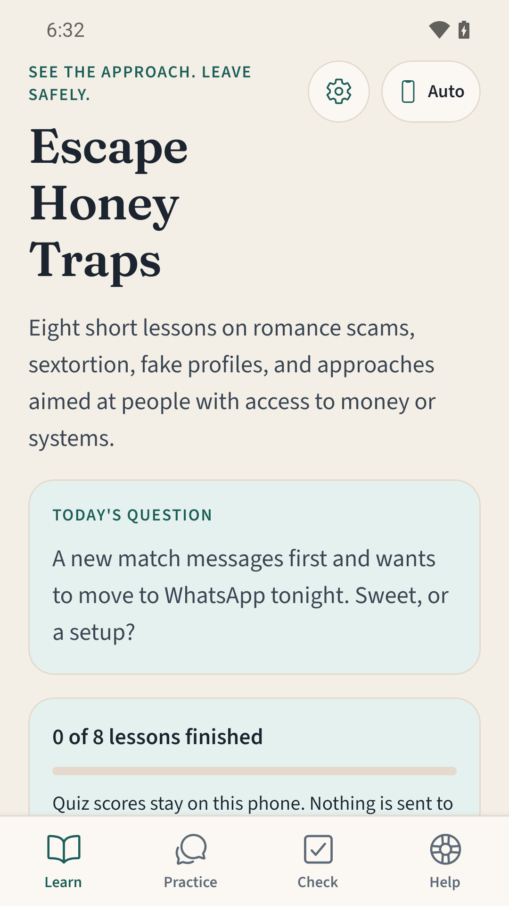
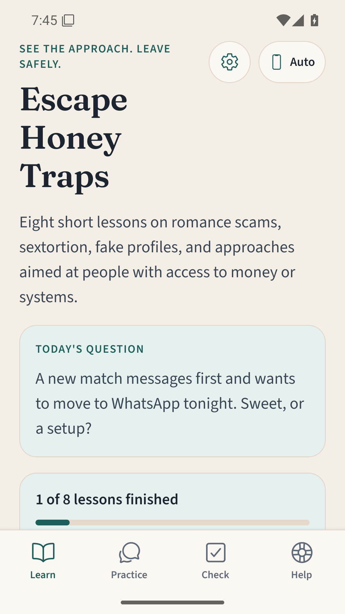

# Escape Honey Traps

A free, open-source Android app that teaches adults how to recognise, avoid, and leave honey traps: romance scams, sextortion, fake profiles, video-call blackmail, and approaches aimed at people whose jobs can reach money or systems.

The tone is calm and practical. The app does not teach anyone how to run a honey trap. There is no account, no ads, and no in-app purchase. Lesson progress and reminder choices stay on the phone.

English is the shipped language. Strings live in `src/content/en/`. To add Hindi or Telugu, copy that folder, translate every string, and register the catalog in `src/content/index.ts`. `getCatalog()` already falls back to English.

Package name: `com.escapehoneytraps.app`. Version 1.1.0 (versionCode 3).

## Screenshots





## License and privacy

[MIT License](LICENSE). Copyright (c) 2026 Sri.

Privacy policy, published with GitHub Pages: [https://srilovesflutter.github.io/escape-honey-traps/privacy/](https://srilovesflutter.github.io/escape-honey-traps/privacy/). The page source is `docs/privacy/index.html`. The same commitments are in `PRIVACY_POLICY.md` and on the in-app Privacy screen.

## Run it on an Android phone with Expo Go

1. Install [Expo Go](https://play.google.com/store/apps/details?id=host.exp.exponent) from Google Play.
2. In this folder:

   ```bash
   npm install
   npx expo start
   ```

3. Put the phone and the computer on the same Wi-Fi.
4. In Expo Go, scan the QR code. This is a development session, not the Play Store build.

`npm run android` starts the same server and asks Expo to open an Android emulator if you have one. `npm run web` is only a layout preview.

## Build a release

Play Console wants an Android App Bundle. The upload keystore stays on your machine. This repo does not contain a `.jks` file, a keystore password, or an `.env` file.

### Cloud build with EAS

```bash
npx eas-cli@latest build -p android --profile preview
npx eas-cli@latest build -p android --profile production
```

`preview` produces an APK. `production` produces an AAB. EAS keeps signing credentials in your Expo account, not in git. `eas.json` uses `"appVersionSource": "local"`, so raise `expo.version` and `expo.android.versionCode` in `app.json` yourself before each Play upload.

### Local build

Signing is read when Gradle runs, from either an untracked `keystore.properties` file or environment variables. The generated `android/` folder is gitignored.

```bash
cp keystore.properties.example keystore.properties
```

Fill `storeFile`, `storePassword`, `keyAlias`, and `keyPassword` in that file. `storeFile` is a path to your upload `.jks`. Or leave the file out and export:

```bash
export EHT_UPLOAD_STORE_FILE=/absolute/path/to/upload.jks
export EHT_UPLOAD_STORE_PASSWORD='your-store-password'
export EHT_UPLOAD_KEY_ALIAS='upload'
export EHT_UPLOAD_KEY_PASSWORD='your-key-password'
```

Environment variables win over the properties file. Then:

```bash
npm install
npx expo prebuild -p android --no-install
cd android && ./gradlew bundleRelease
```

The AAB is `android/app/build/outputs/bundle/release/app-release.aab`. `./gradlew assembleRelease` writes an APK next to it. Do not commit either file. If no upload key is configured, the release build falls back to the debug keystore so a local install still works. Play will reject that debug signature.

## What is in the app

Four tabs:

- **Learn.** Eight short lessons. Each one is cards, takeaways, and a three-question quiz. Best scores stay on the device. A daily teaser poses one hypothetical “is this a trap?” question.
- **Practice.** Fictional “choose your reply” drills. A training banner stays on screen. Nothing is sent.
- **Check.** A red-flag checklist and a plain-language reading. Ticks are not saved.
- **Help.** Steps for someone who is being blackmailed, plus helplines checked on 13 November 2026: 1930, [cybercrime.gov.in](https://cybercrime.gov.in/), [StopNCII.org](https://stopncii.org/), 112, 181, 14490, and iCall.

Settings (the gear on Learn) holds the theme and the on-device reminders. Android 13 and newer asks for notification permission only after a reminder is turned on. Lock-screen text is a hypothetical question, not anything about the person using the phone.

Store listing copy is in `STORE_LISTING.md`.

## Checks

```bash
npm run typecheck
npm run lint
```

## Fonts

Headings use Fraunces (Undercase Type). Body text uses Source Sans 3 (Adobe). Both are under the SIL Open Font License 1.1, via `@expo-google-fonts/fraunces` and `@expo-google-fonts/source-sans-3`.
